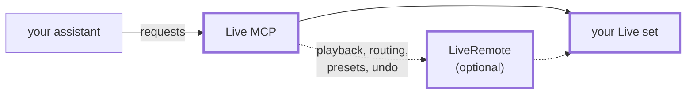

# Live MCP

Let an AI assistant work in your Ableton Live set. Ask Claude Code or GitHub Copilot to look at your tracks, turn
knobs, write a bass line into a clip or find the parameter you are looking for, and it does it in Live while you
watch.

## Install

You need **Live 12 Suite**, version 12.4.15 or later. Extensions are in Ableton's
[public beta](https://ableton.github.io/extensions-sdk/) for now, and only in Suite.

1. Download the `.ablx` file from the [latest release](https://github.com/norrby/live-mcp/releases/latest).
2. In Live, open **Settings → Extensions** and drag the file there.
3. Connect your assistant with one command in a terminal.

   Claude Code:

   ```sh
   claude mcp add -s user --transport http live http://127.0.0.1:9871/mcp
   ```

   VS Code with GitHub Copilot:

   ```sh
   code --add-mcp '{"name":"live","type":"http","url":"http://127.0.0.1:9871/mcp"}'
   ```

That's it. Ask your assistant *"What's in my Live set?"* to try it.

**Optional, for more:** in Live's **Settings → Link, Tempo & MIDI**, pick **LiveRemote** as a Control Surface. The
extension has put it there for you. It lets the assistant also start and stop playback, undo, change routing, and
load presets and plug-ins.

## What you can ask

- *"Which devices are on the bass track, and what are their settings?"*
- *"Turn the filter cutoff on the synth down to about a third, and the resonance up a little."*
- *"Make a four-bar clip in the first empty slot with a simple bass line in E minor."*
- *"Double the velocity of every note in that clip, and mute it."*
- *"Add a Reverb to the vocals and a Utility after it."*
- *"What did I change since you last looked?"*
- *"Load my preset called Warm Pad on a new MIDI track."* (needs LiveRemote)

## How it works

The assistant sends its requests to Live MCP, which runs inside Live and changes your set. LiveRemote, if you
turned it on, handles what Live does not let extensions do.



The boxes with a thick border are inside Live.

## Good to know

- **Undo works.** Everything the assistant changes goes into Live's undo history, like your own edits.
- **Only your computer can reach it.** Other computers and web pages cannot. If you want a password on top, see
  [docs/development.md](docs/development.md#configuration).
- **Some things are out of reach** for any add-on in Live today: automation, recording, freezing, and the
  MIDI To and Audio From of an External Instrument. For the last one, set them once yourself, save the device as a
  preset, and ask the assistant to load that preset.
- **Ask it what it can do.** The assistant can ask Live MCP itself, and gets an honest answer for your setup.

Not affiliated with or endorsed by Ableton. Use at your own risk.

## More

- [docs/architecture.md](docs/architecture.md): how Live MCP works, from the big picture down.
- [docs/development.md](docs/development.md): building it yourself, configuration, the full list of tools.

## License

Copyright (c) 2026 norrby. MIT License; see [LICENSE](LICENSE).
