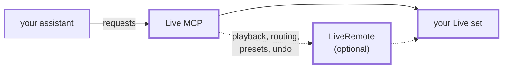

# Live MCP

Let an AI assistant work in your Ableton Live set. Ask Claude, GitHub Copilot or Cursor to look at your tracks, turn
knobs, write a bass line into a clip or find the parameter you are looking for, and it does it in Live while you
watch.

## Install

Live MCP is a Live **extension**, so it only runs in a Live that has extensions: **Live 12 Suite, version 12.4.15 or
later**. For now that means Ableton's [public beta](https://ableton.github.io/extensions-sdk/); extensions are not in
Live Standard, Intro or older versions, and without them Live MCP does not work at all.

1. Download the `.ablx` file from the [latest release](https://github.com/norrby/live-mcp/releases/latest).
2. In Live, open **Settings → Extensions** and drag the file there.
3. Connect your assistant.

   Claude Code:

   ```sh
   claude mcp add -s user --transport http live http://127.0.0.1:9871/mcp
   ```

   VS Code with GitHub Copilot:

   ```sh
   code --add-mcp '{"name":"live","type":"http","url":"http://127.0.0.1:9871/mcp"}'
   ```

   Claude Desktop: open **Settings → Developer → Edit Config**, add `live` under `mcpServers` as below, and restart
   Claude Desktop. It needs [Node.js](https://nodejs.org) to reach Live MCP.

   ```json
   {
     "mcpServers": {
       "live": { "command": "npx", "args": ["-y", "mcp-remote", "http://127.0.0.1:9871/mcp"] }
     }
   }
   ```

   Cursor: open **Settings → MCP → Add new MCP server**, or edit `~/.cursor/mcp.json`, and add `live`:

   ```json
   {
     "mcpServers": {
       "live": { "url": "http://127.0.0.1:9871/mcp" }
     }
   }
   ```

That's it. Ask your assistant *"What's in my Live set?"* to try it.

### Optional: the LiveRemote bridge

Live does not let extensions do everything. A small helper script, LiveRemote, lets the assistant also start and
stop playback, undo, change routing, load presets and plug-ins, and read the full parameter names of Max for Live
devices.

1. Download `LiveRemote.zip` from the same release.
2. Unzip it into the **Remote Scripts** folder of your User Library, so that you get a folder called `LiveRemote`
   there. Create Remote Scripts if it is missing.
   - Mac: `~/Music/Ableton/User Library/Remote Scripts/`
   - Windows: `Documents\Ableton\User Library\Remote Scripts\`
3. Restart Live.
4. In **Settings → Link, Tempo & MIDI**, pick **LiveRemote** as a Control Surface, with Input and Output set to
   None.

Ask your assistant *"Can you reach the LiveRemote bridge?"* to check.

## What you can ask

- *"Which devices are on the bass track, and what are their settings?"*
- *"Turn the filter cutoff on the synth down to about a third, and the resonance up a little."*
- *"Make a four-bar clip in the first empty slot with a simple bass line in E minor."*
- *"Double the velocity of every note in that clip, and mute it."*
- *"Add a Reverb to the vocals and a Utility after it."*
- *"What did I change since you last looked?"*
- *"Put the bass line from bassline.mid in my User Library on the bass track, at bar 9."*
- *"Is the vocal track clipping anywhere in the chorus, and how loud is it?"*
- *"Load my preset called Warm Pad on a new MIDI track."* (needs LiveRemote)
- *"In that clip, let the filter open slowly over four bars and close again."* (needs LiveRemote)

## How it works

The assistant sends its requests to Live MCP, which runs inside Live and changes your set. LiveRemote, if you
turned it on, handles what Live does not let extensions do.



The boxes with a thick border are inside Live.

## Guardrails

An assistant works fast and sometimes gets things wrong. Live MCP makes mistakes less likely and easy to take back:

- **All or nothing.** Before it changes anything, Live MCP checks the whole request: every track, device and clip
  it names, and every value against what the control allows. If one thing is wrong, nothing is changed, and the
  assistant is told what was wrong.
- **Undo works.** Everything the assistant changes goes into Live's undo history, like your own edits. When it
  deletes or changes several things at once, one undo (Cmd+Z or Ctrl+Z) brings them all back.
- **Controls that wait for you.** A Max for Live device can mark a control, for example a button that overwrites a
  synth's memory, by ending its help text with `[ask first]`. Live MCP then changes that control only when you have
  asked for it.
- **Recording where you meant.** The assistant names the tracks it records on. If Live would record on any other
  track as well, for example the MIDI track you just clicked on, nothing starts and the assistant is told why.
  Afterwards it is told what the take added and replaced.
- **Look, don't touch.** In the status dialog (right-click a track, **Live MCP status…**) you can make Live MCP
  read-only: the assistant can look at your set and measure it, but not play or change anything.

## Good to know

- **See what is going on.** Right-click a track or a scene and choose **Live MCP status…**: whether the assistant
  is connected, whether LiveRemote answers, the commands to connect, and a switch for a password.
- **Only your computer can reach it.** Other computers and web pages cannot. If you want a password on top, see
  [docs/development.md](docs/development.md#configuration).
- **Some things are out of reach** for any add-on in Live today: automation in the arrangement (automation in
  session clips works), freezing, and the MIDI To and Audio From of an External Instrument. For the last one, set them once yourself, save the device as a
  preset, and ask the assistant to load that preset.
- **Ask it what it can do.** The assistant can ask Live MCP itself, and gets an honest answer for your setup.
- **Max for Live devices can explain themselves.** Live MCP reads the help text Live shows in its Info View for
  each control, and the device's description, and gives them to the assistant. See
  [For Max for Live authors](docs/development.md#for-max-for-live-authors).

Not affiliated with or endorsed by Ableton. Use at your own risk.

## More

- [docs/architecture.md](docs/architecture.md): how Live MCP works, from the big picture down.
- [docs/development.md](docs/development.md): building it yourself, configuration, the full list of tools.
- [docs/field-notes.md](docs/field-notes.md): the bugs met while building it, how they were found and fixed.

## License

Copyright (c) 2026 norrby. MIT License; see [LICENSE](LICENSE).
