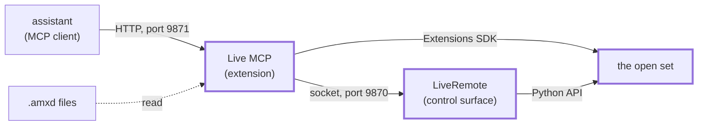
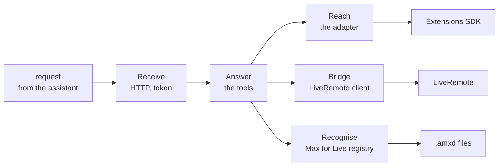
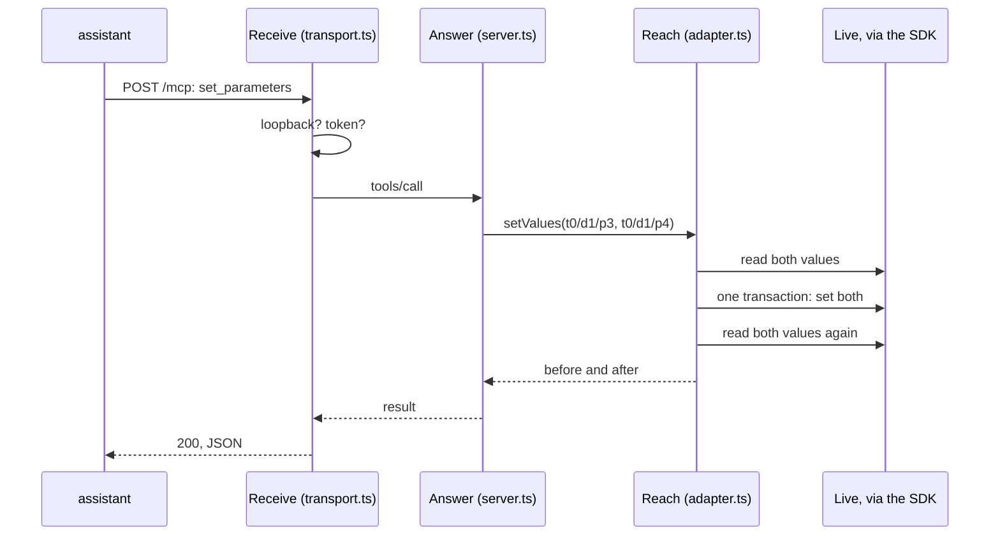
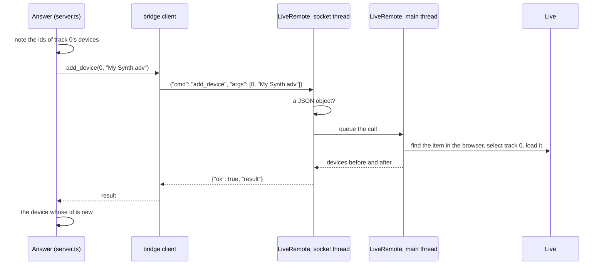
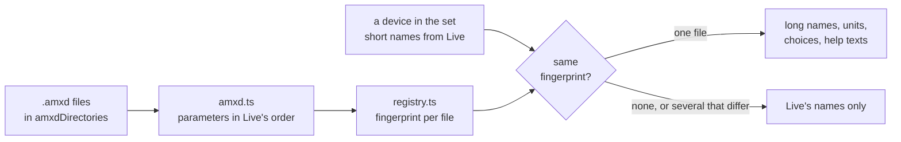

# Architecture

This document starts with the big picture and adds detail one layer at a time. The stories behind some of the
design choices are collected at the end.

## 1. The big picture

Five things take part: an **assistant**, the **Live MCP extension**, **Live** with the open set, the optional
**LiveRemote bridge**, and the **device files** on disk.

- **The assistant** is an MCP client such as Claude Code or GitHub Copilot, running on the same computer. It sends
  *tool calls*: requests like "list the parameters of this device" or "set these three values".
- **The Live MCP extension** runs inside Live, in the *Extension Host*: a Node.js process that Live starts for its
  extensions. It receives the tool calls over HTTP and answers them.
- **Live** holds the open set. The extension reads and changes it through the *Extensions SDK*, the API Live gives
  its extensions.
- **The LiveRemote bridge** is a control surface script, the older kind of Live add-on written in Python. It
  reaches what the Extensions SDK does not: routing, transport, selection, undo and the browser. It is optional.
- **The device files** are the `.amxd` files of Max for Live devices. The extension reads them to learn what a Max
  for Live device's parameters are called and mean, which Live itself does not tell.

So the assistant talks to one server, and that server reaches Live by two roads: the SDK always, the bridge when it
is installed.

The boxes with a thick border are inside Live.

## 2. The extension's five jobs

Between the assistant and Live, the extension does five jobs: **Receive**, **Answer**, **Reach**, **Bridge** and
**Recognise**.

- **Receive:** an HTTP server takes each request, checks that it comes from this computer (and carries the token,
  if one is set), and hands the MCP messages on.
- **Answer:** the *MCP server* knows the tools: their names, their arguments and what each one does. It runs the
  tool and turns the result, or the error, into an answer the assistant can read.
- **Reach:** the *adapter* is the only part that touches the SDK. It finds objects by address, reads them, and
  changes them in undoable steps.
- **Bridge:** the *bridge client* sends a command to LiveRemote and waits for its answer, for the tools the SDK
  cannot serve.
- **Recognise:** the *registry* knows the `.amxd` files and recognises a Max for Live device in the set from its
  parameter names, so the answers can carry long names, units and help texts.

Answer is in the middle: it uses Reach for almost every tool, Bridge for some, and Recognise whenever a device's
parameters are shown.

## 3. The five jobs as files

Each job lives in its own folder under `src/`:

| Job | Files |
|---|---|
| Receive | `src/mcp/transport.ts` |
| Answer | `src/mcp/server.ts` (the tools), `src/mcp/capabilities.ts` (what can and cannot be done) |
| Reach | `src/live/adapter.ts`, `src/live/address.ts`, `src/live/errors.ts`, `src/live/changes.ts` (noticing edits) |
| Bridge | `src/bridge/client.ts`, and on the other side `remote/LiveRemote/LiveRemote.py` |
| Recognise | `src/m4l/amxd.ts` (reads one file), `src/m4l/registry.ts` (knows them all) |

`src/extension.ts` is where Live starts the extension. It reads the configuration (`src/config.ts`), creates one
of each part, and starts the HTTP server. `src/prelude.ts` runs before everything else; section 10 explains why.

## 4. Addresses

Every tool names the objects it works on by an **address**, a short path from a track down to what it holds.

- **Tracks:** `t0` is the first track, `r0` the first return track, `main` the main track.
- **On a track:** `d1` is the second device, `s3` the fourth session clip slot (and the clip in it), `a0` the
  first arrangement clip in time order, `vol`, `pan` and `send0` the mixer.
- **In a device:** `p3` is the fourth parameter. A rack device has chains, `c0`, and those have devices again.
- **By id:** `#123` is any object by the id Live gave it.

So `t0/d1/p3` is the fourth parameter of the second device on the first track, and `t0/d1/c0/d0` is the first
device in the first chain of a rack.

Positional addresses are easy to read but shift when something moves: delete the first device and `t0/d1` becomes
`t0/d0`. An `#id` stays valid as long as the object exists, so every tool that creates something answers with its
id as well.

`src/live/address.ts` parses an address into steps; the adapter's `step()` walks them from the set downwards.

## 5. One tool call, all the way to Live

The path passes the HTTP server, the MCP server, the adapter and the SDK. Example: the assistant sets the cutoff
and resonance of a filter in one call, `set_parameters` with `t0/d1/p3 = 0.7` and `t0/d1/p4 = 0.3`.

- **Receive** checks the request and creates a fresh MCP server for it. Each request is handled on its own; the
  server keeps no session between requests.
- **Answer** checks the arguments against the tool's schema and calls the adapter.
- **Reach** looks up both parameters, reads their values, and sets both inside one *transaction*: the SDK's way of
  making several changes one undo step in Live. Then it reads the values again.
- The answer lists each parameter with its value before and after. A value Live rejects is reported for that
  parameter alone; the others are still set.

If Live does not answer within 60 seconds, the HTTP server answers with an error instead, saying that the change
may still happen.

## 6. The bridge

The bridge involves two programs: the **bridge client** in the extension and the **LiveRemote** script in Live.
They talk over a socket on `127.0.0.1:9870`, one line of JSON per call: a command name and its arguments. The
answer is one line back.

- **Fixed commands:** every command is a method `cmd_<name>` in `LiveRemote.py` with fixed arguments. A command
  that does not exist is refused; nothing sent over the socket is run as code.
- **Only our protocol:** LiveRemote closes a connection at the first line that is not a JSON object. A web page
  can only send HTTP, whose first line never is, so a web page never reaches a command.
- **Installing:** the user unzips LiveRemote into `Remote Scripts/` in the User Library and picks it as a Control
  Surface in Live's settings. The extension cannot do it, because it may not write outside its own folder, and no
  API reaches Live's settings.
- **No token by default:** LiveRemote listens on this computer only, like the MCP server, so a token would keep
  out only programs that could use the MCP server anyway. A user who wants one puts it in `.liveremote-token`
  next to `LiveRemote.py` and in the extension's configuration.
- **The main thread:** Live allows changes to the set only from its own main thread. LiveRemote's socket runs in a
  thread of its own, so it puts each call in a queue. A function that Live calls on its main thread about ten
  times a second empties the queue, runs the commands and hands back the answers.

Example: `load_browser_item` loads a saved preset onto track 0.

The new device is found by its id rather than by the names LiveRemote reports, because Live places a loaded item
after the selected device, not always last.

Without the bridge, or with LiveRemote not running, every bridge tool answers with what is missing and how to fix
it. `get_capabilities` asks LiveRemote for a `ping` to tell which of the two it is.

## 7. Recognising Max for Live devices

Recognising involves the **`.amxd` reader**, the **registry** and the **fingerprint**.

- **The problem:** for a Max for Live device, Live reports only each parameter's short name, and those repeat: a
  synth editor may have twelve parameters called "A". The long names, units, choices and help texts are only in
  the device's `.amxd` file.
- **The reader** (`amxd.ts`) opens an `.amxd` file, frozen or not, finds the patcher inside it, and lists the
  parameters in the order Live shows them: Live's own "Device On" first, then the visible parameters sorted by
  long name.
- **The registry** (`registry.ts`) reads every `.amxd` file in the configured folders, and reads a file again only
  when it has changed. An installed extension may not read those folders, so then the registry asks the bridge to
  list and read the files instead (the commands `amxd_list` and `amxd_read`, which read `.amxd` files and nothing
  else). That happens in the background, so a device is recognised from the next call after the files arrive.
- **The fingerprint** is the list of short names in that order. When a tool shows a device, the registry compares
  the device's names in Live with every file's fingerprint. Exactly one match means the device is recognised.

A frozen and an unfrozen copy of the same device have the same fingerprint and the same parameters, and count as
one match.

A recognised device also brings two things the assistant needs to drive it without being told:

- **The device's own description,** the text its author wrote in the patcher's description. It reaches the
  assistant as `about`, so an author can say there how the device is meant to be used.
- **The controls Live does not see,** such as stored tables or hidden buttons, each with the visible parameters
  whose names start the same way. A step editor stores its table out of Live's reach but is edited through
  parameters like "Osc 1 Table Step" and "Osc 1 Table Wave", and this is how the assistant finds them.
- **The parameters to change only on request.** An author ends a parameter's help text with `[ask first]`, for an
  action such as sending a patch to a synth or storing it. Live MCP lists such parameters as `askFirst`, and
  refuses to change one from its default unless the call says `userAsked: true`. Text alone was not enough: a test
  assistant read "harmless" in a description and sent a patch three times on its own.

## 8. Noticing your edits

Live gives extensions no events, so the extension cannot be told when you turn a knob. `get_changes` makes up for
it with **snapshots** and a **cursor**.

- **A snapshot** is the whole set as data: tempo, tracks, devices, every parameter value, the mixer. Reading it
  takes tens of milliseconds even for a large set.
- **A cursor** is a name the assistant picks. The extension keeps the last snapshot per cursor.
- **A call** takes a new snapshot and compares it with the cursor's previous one. The answer lists what was added,
  removed, renamed, moved or changed in value.

An assistant that wants to follow your work calls `get_changes` now and then, instead of reading the whole set
each time. Objects are compared by id, so a track that moves is reported as moved, not as one removed and one
added.

## 9. Safety

Safety is in three places: who may connect, what a call may do, and how a change can be taken back.

- **Who may connect:** the HTTP server listens on `127.0.0.1` only and refuses a request whose Host or Origin is
  not this computer. By default there is no token: any program on this computer may connect, as with an MCP server
  a client starts itself, but a request with an Origin header, which every web page sends, is refused. With a
  token set in `config.json`, every request must carry it.
- **What a call may do:** each tool checks its arguments against a schema before anything happens. The bridge only
  runs its fixed commands, and only for a line of JSON, never for a web page's request. Neither runs code it is
  sent.
- **Taking it back:** changes go through Live's undo. Several parameters in one call, or a clip and its notes, form
  one undo step.

## 10. How it is built and run

The build turns `src/` into one file, `dist/extension.js`, with esbuild. The SDK and every other dependency are
bundled into that file, because the Extension Host loads one file and no `node_modules`. `npm run package` builds
a minified version and packs it with `manifest.json` into a `.ablx` file, the format Live installs, and zips the
LiveRemote folder next to it.

While developing, `npm run host` (`tools/host.mjs`) starts Live's own Extension Host with this project as its
extension, so a change needs only a new build and a restart of the host, not of Live.

The code runs in three places:

| | Runs in | Files |
|---|---|---|
| Extension | Live's Extension Host (Node.js) | `src/`, bundled into `dist/extension.js` |
| Bridge | Live's Python, as a control surface | `remote/LiveRemote/` |
| Tests, tools | Node.js | `test/`, `tools/` |

## 11. Tests

`npm test` runs every `test/*.test.ts` with Node's built-in test runner, without Live. `test/fake-host.ts` plays the
part of Live behind the SDK: it keeps a small set in memory and answers the SDK's calls from it. The tests then run the real SDK,
the adapter, the MCP server and the HTTP server, with a real MCP client on the other end, and check both the
answers and what changed in the fake set, including how many undo steps a call made.

The `.amxd` reader is tested with small patchers built in the test. A test against a real device runs when the
environment variables `AMXD_FROZEN`, `AMXD_UNFROZEN` and `AMXD_LIVE_PARAMS` point to the files.

## 12. Why it is built this way

Some choices above look odd until you know what happened.

- **The HTTP server is written by hand.** The MCP library's own HTTP transport builds on the web's Request and
  Response objects, and the Extension Host does not have them. The hand-written one does only what an MCP client
  needs: JSON in, JSON out, one fresh server per request.
- **`prelude.ts` copies globals.** The Extension Host runs an extension in a bare context without `URL`,
  `TextEncoder`, `crypto` or `fetch`, and the MCP library needs several of them. The prelude fetches the real ones
  from Node and installs them before anything else runs. It copies them by name, because merely listing the
  globals touched one that made the whole process abort.
- **`tools/host.mjs` instead of Ableton's CLI.** The CLI gives the Extension Host ten seconds to connect, and a
  first start often takes longer, so the CLI killed it. The script starts the host without that limit.
- **Files go through the bridge or through Live.** An installed extension may read and write only its own
  folders. The development host has no such limit, so this showed only when the first `.ablx` was installed: the
  bridge's token file, the `.amxd` files and the Remote Scripts folder were all out of reach. Now the bridge needs
  no token and reads the `.amxd` files, Live imports audio files, and the user installs the bridge.
- **No External Instrument routing.** The MIDI To and Audio From of Live's External Instrument are not in the
  Extensions SDK, and the Python object behind the device has no routing at all; only Max for Live devices expose
  routing points. A preset saved from Live's window keeps the routing, so the way is a preset loaded through the
  browser.
